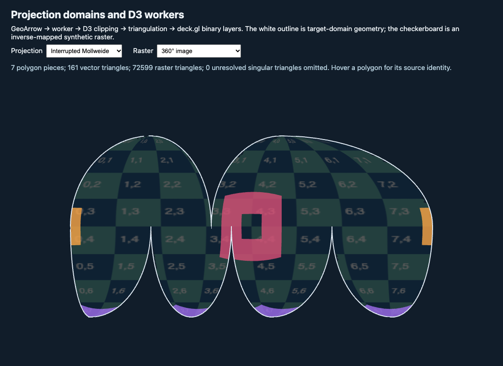

# Projection domains and D3 workers

Run `yarn && yarn start` here. Run `yarn test` for geometry regressions and `yarn build` for the TypeScript and production-worker build.

See [the guide](../../../docs/developer-guide/projection-domains.md) for the pipeline, ownership of transferred buffers, source-feature identity and limitations. This standalone example uses published deck.gl packages and keeps D3, GeoArrow and earcut dependencies local to the example.

The target-domain outline and vector features are streamed and triangulated in a worker. Raster construction currently runs on the main thread; its bounded refinement can take several seconds for interrupted projections. The UI reports singular triangles omitted at its refinement limit. This is an experimental recipe, not a general raster reprojection implementation.

